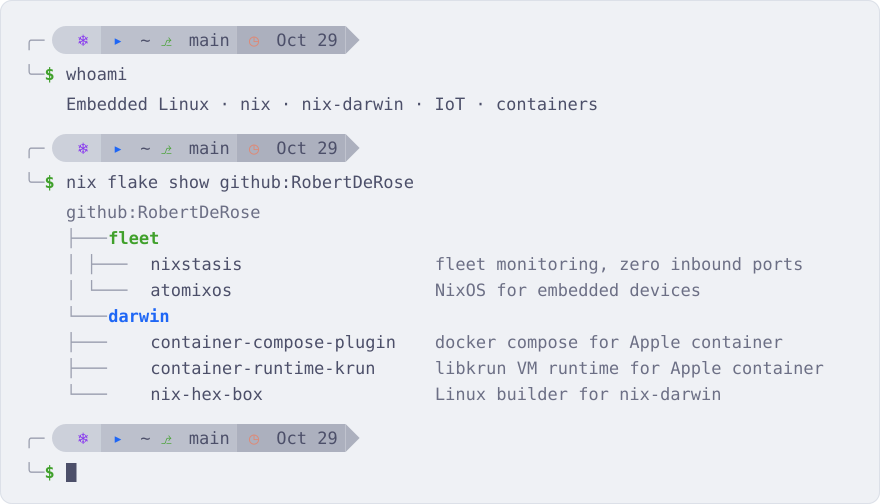
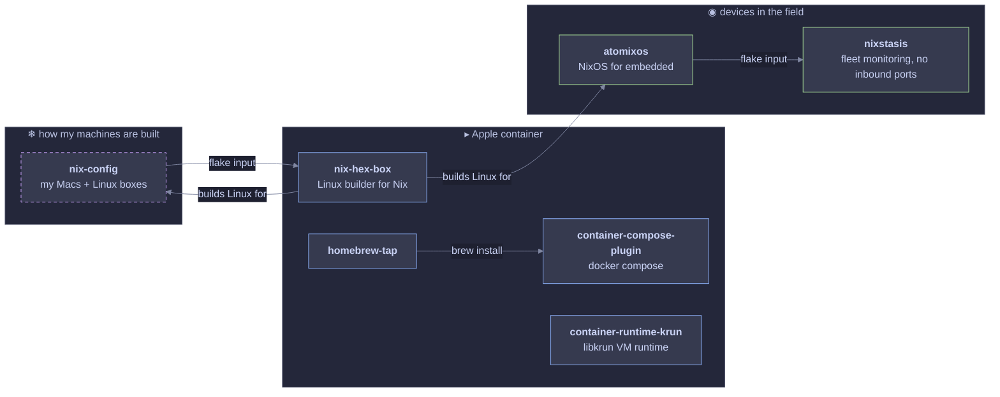

<picture>
  <source media="(prefers-color-scheme: dark)" srcset="banner-dark.svg">
  
</picture>

### Building

- [nixstasis](https://github.com/RobertDeRose/nixstasis): monitor and reach an IoT fleet with zero inbound ports on the devices. Elixir.
- [atomixos](https://github.com/RobertDeRose/atomixos): NixOS trimmed for embedded devices.
- [container-compose-plugin](https://github.com/RobertDeRose/container-compose-plugin): `docker compose` for Apple `container`. Swift.

### Experimental

- [container-runtime-krun](https://github.com/RobertDeRose/container-runtime-krun): swap in libkrun as Apple `container`'s VM runtime.
- [nix-hex-box](https://github.com/RobertDeRose/nix-hex-box): a nix-darwin Linux builder running on Apple containers.

### Recently shipped

<!-- releases:start -->
| Release | Date |
| --- | --- |
| [atomixos v0.1.0](https://github.com/RobertDeRose/atomixos/releases/tag/v0.1.0) | 2026-10-29 |
| [nixstasis v0.3.0](https://github.com/RobertDeRose/nixstasis/releases/tag/v0.3.0) | 2026-10-22 |
| [nix-hex-box v1.3.0](https://github.com/RobertDeRose/nix-hex-box/releases/tag/v1.3.0) | 2026-10-22 |
| [container-compose-plugin v0.3.0](https://github.com/RobertDeRose/container-compose-plugin/releases/tag/v0.3.0) | 2026-10-18 |
<!-- releases:end -->

  <samp>
    <a href="https://robertderose.github.io">site</a> ·
    <a href="https://github.com/RobertDeRose?tab=repositories">projects</a> ·
    <a href="https://github.com/RobertDeRose/homebrew-tap">homebrew tap</a> ·
    <a href="https://www.linkedin.com/in/RobertDeRose">linkedin</a> ·
    <a href="https://gitlab.com/RobertDeRose">gitlab</a>
  </samp>

